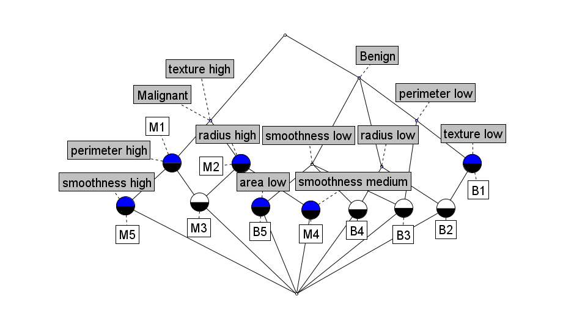

# SVN-FCA-IC: single-valued neutrosophic formal concept analysis for readable and selective rule-based classification

Code and result files for the manuscript "Single-valued neutrosophic formal concept analysis for readable and selective rule-based classification" (title as in the submitted version).

SVN-FCA-IC is a rule classifier. It mines rules from a formal context of equal-frequency (tertile) categories, selects the rules by a purity that is relative to the class frequency, describes each category with a triangular membership, and combines the evidence of the strongest rules into a margin. Cases with a small margin can be withheld (abstention). The method is evaluated on the Wisconsin diagnostic breast cancer (WDBC) data and on eight further binary data sets.

## Contents

```
notebooks/   Three Google Colab notebooks that produce all experimental results
src/         The model and evaluation code (the notebooks write the same three files)
  svnfca.py    first version (fixed purity 0.85) and shared helpers
  svnfca2.py   SVN-FCA-IC, second version (the method of the paper)
  svn_eval.py  repeated cross-validation, corrected resampled t-test, McNemar test, Holm adjustment
analysis/    Scripts that were run outside the notebooks (see below)
results/     Result files of the notebooks and of the analysis scripts
conexp/      Context file of the ten strongest rules (rules_top10.cxt) for the lattice in Fig. 4
environment.json   Software versions of the runs
```

## How to run

1. Open a notebook in Google Colab and choose *Runtime, then Run all*. No upload is needed. The WDBC data come from scikit-learn. Notebook 02 downloads the other data sets and needs internet access.
2. Each notebook writes its result files to a folder `results/` and offers them as a zip file at the end.
3. Run order: 01, then 02, then 03. Notebook 03 uses the same folds and features as the earlier notebooks, and the method SVN-FCA-IC is not run again in it.

| Notebook | Content | Expected run time (from the notebook header) |
|---|---|---|
| 01_SVN_FCA_IC_v2_WDBC_main | WDBC: hold-out split, repeated cross-validation, ablation, abstention, sensitivity, ten features | 8 to 15 minutes |
| 02_SVN_FCA_IC_v2_nine_datasets | Nine data sets with the standard classifiers and RIPPER | 25 to 45 minutes |
| 03_SVN_FCA_IC_v2_tuned_baselines | Tuned logistic regression, decision tree, random forest, SVM and kNN on all nine data sets | see the notebook header |

## Analysis scripts

These four scripts use the result files of the notebooks. Run them from the folder `analysis/` (the paths are relative).

| Script | Output | Used for |
|---|---|---|
| an3.py | `results/tuned_baselines/paired_tuned.csv`, `wdbc_tuned_tests.csv`, `cross_tuned.json`, `ba_matrix_tuned.csv` | Tests of SVN-FCA-IC against the tuned models (Tables 5 and 11 and the text of Sections 4.2 and 4.4) |
| an4.py | `results/tuned_baselines/interp_cv.csv` | Size of the decision-tree and RIPPER rule bases (Table 7) |
| an5.py | `results/tuned_baselines/interp_svn_cv.csv` | Number and length of the rules of SVN-FCA-IC per training fold (Table 7) |
| an6.py | printed output | Closed-antecedent rule base, number of rules and conditions (Table 7) |

The result file `results/tuned_baselines/cv_folds_tuned.csv`, `holdout_tuned.csv`, `summary_tuned.csv` and `best_settings_tuned.csv` come from notebook 03.

## Settings

- Hold-out: stratified split 80/20 with `random_state=42` (455 training and 114 test cases).
- Repeated cross-validation: stratified 5-fold, 10 repeats, `random_state=2024` (50 folds).
- WDBC: the first five mean features (radius, texture, perimeter, area, smoothness). Other data sets with more than five features: the five largest ANOVA F values in the training fold.
- Rule mining: minimum extent max(5, ceil(0.02 n)), maximum antecedent length 5.
- Parameters (delta, k) of SVN-FCA-IC: selected by inner five-fold cross-validation on the training part, criterion balanced accuracy. Abstention threshold tau = 0 in the main experiments.
- Tuned comparison models: inner five-fold cross-validation on the training part, criterion balanced accuracy. The grids are listed in Table 2 of the manuscript and in notebook 03.

## Software

Python 3.13.18, numpy 2.4.6, pandas 2.2.3, scipy 1.16.3, scikit-learn 1.6.1, matplotlib 3.10.0, wittgenstein 0.3.5 (RIPPER). See `environment.json`.

## Data

All data sets are public: WDBC (scikit-learn, UCI Machine Learning Repository), and the further data sets from the UCI repository, the Penn Machine Learning Benchmarks and OpenML. The source of each data set is given in Table 1 of the manuscript and in `results/nine_datasets/dataset_info.json`. No data are redistributed in this repository.

## Lattice (Fig. 4)

Load `conexp/rules_top10.cxt` in ConExp (File, then Open) and draw the concept lattice. The drawing used in the paper is `conexp/lattice_fig4.png`. The context has 10 objects (the rules B1 to B5 and M1 to M5) and 12 attributes. The lattice has 17 concepts.



## Use of large language models

Large language models (ChatGPT and Claude) were used to assist in writing the analysis code and in drafting the text. The code was run by the authors, and the authors checked the results.

## Citation and licence

Citation: please cite the Zenodo record of this repository (the DOI is shown on its Zenodo page) and the associated manuscript.
Licence: MIT (see the file LICENSE).
